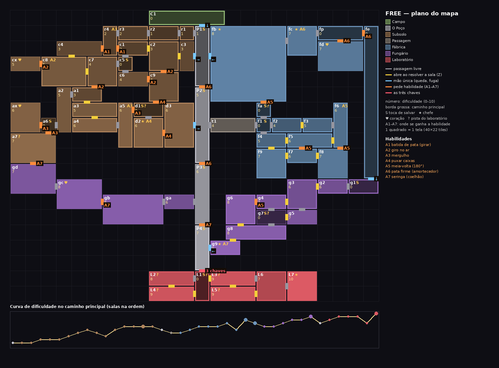

# FREE como metroidvania: análise e plano do mapa

> **Estado: só planejamento (D118).** Nada daqui está implementado. O mapa, as tabelas e a curva saem
> de `tools/world/plano_mapa.py` (`python3 tools/world/plano_mapa.py` gera `docs/plano-mapa.png`, as
> tabelas e a checagem de progressão). Mudou o plano? Mude os dados lá e rode de novo.

## 1. A proposta em poucas linhas

- **Um mundo só, contínuo**, no lugar das 33 fases em fila: **66 salas** (cerca de 238 telas)
  ligadas por saídas na parede, em volta de uma espinha vertical, **o Poço**: o buraco onde o coelho
  cai na abertura, que atravessa os três mundos e termina no **Laboratório**.
- **Os três mundos** ficam onde a história já os põe: o **Subsolo** a oeste e no alto, a **Fábrica**
  do Gatsby a leste, o **Fungário** embaixo de tudo, largo. O **Laboratório** fica no fundo, embaixo
  do Poço, fechado pela **porta das três luzes** (uma chave por chefe).
- **O giro vira o centro da progressão:** em vez de vir pronto, ele cresce em **sete habilidades**
  (A1–A7), uma por etapa, e cada uma abre caminhos novos **e muda salas antigas** na volta.
- **Dificuldade crescente** de 1 a 10 no caminho principal (49 salas), com descanso depois de cada
  chefe, e segredos opcionais (4 corações, pistas do laboratório) mais difíceis que o entorno.
- **Quase tudo que existe é aproveitado:** as 33 fases entram, mantidas, ampliadas ou refeitas. As
  salas novas são sobretudo corredores, tocas de salvar, ligações entre mundos, segredos e o
  Laboratório.

## 2. Análise das fases existentes

### 2.1 O que há hoje

33 fases em fila (`levels/campaign/ordem.json`), em três atos e quatro chefes:

| Ato | Fases | Tamanho típico | Mecânicas | Chefes |
|---|---|---|---|---|
| 1. Subsolo (raízes, cavernas, aquífero, despensa) | 17 | 1 tela (20–40 × 10–22); 3 verticais de 2 telas | caixa e compartimento, comporta, plataforma por orientação, espinho, corda, água, ralo, limitador (Maré, Fuga) | Jeffrey (bloco giratório, nozes) |
| 2. Fábrica do Gatsby | 10 | 1 tela; a Passagem (150×26) e a corrida (186×107) já são "mundo" | bateria, alavanca, calha, esteira, prensa, vapor, ventilador, placa, plataforma móvel, chão que desaba; limitador em quase todas | a corrida do Gatsby, a mecha |
| 3. Fungário | 6 | 1 a 1,5 tela, horizontais | broto, cogumelo-mola, cogumelo murcho, bufa-esporos; limitador em todas | Senzi (perseguição, seringa, ringue) |

| # | Fase | Tamanho | O que ensina | No plano |
|---|---|---|---|---|
| 1 | passos | 20×10 | andar, pular, caixa | **r1**, mantida |
| 2 | degraus | 29×14 | caixa como degrau | **r2**, ampliada |
| 3 | giro | 18×15 | o primeiro giro | **r4**, Toca do susto: ganha A1 |
| 4 | comporta | 30×12 | comporta | **c1**, mantida |
| 5 | derrame | 36×16 | comportas em cadeia | **c2**, ampliada (2×2) |
| 6 | toca | 38×14 | caixa longe | **c4**, mantida |
| 7 | setas | 20×16 | plataforma por orientação | **c3**, vira atalho de volta ao Poço |
| 8 | espinhos | 28×20 | espinho + plataforma | **c6**, mantida |
| 9 | prumo | 36×22 | corda | **c7**, refeita (a corda briga com as saídas na parede, D100) |
| 10 | vertigem | 38×20 | tudo do subsolo seco | **c8**, ampliada: ganha A2 |
| 11 | agua | 24×22 | água, ralo | **a1**, mantida |
| 12 | mare | 12×25 | água + limitador | **a2**, mantida |
| 13 | represa | 40×17 | água + espinho | **a3**, mantida |
| 14 | naufragio | 40×19 | água + caixa | **a4**, mantida |
| 15 | mergulho | 22×36 | água funda, corda | **a5**: ganha A3 |
| 16 | fuga | 32×36 | limitador, fuga | **d3**, ampliada: a fuga depois do Jeffrey |
| 17 | jeffrey | 40×22 | chefe | **d2**: ganha A4 e a chave 1 |
| 18 | passagem | 150×26 | plataformas móveis, esteira | **t1**: a ligação Subsolo → Fábrica |
| 19 | linha-de-montagem | 28×11 | bateria, alavanca, calha | **f2**, mantida |
| 20 | esteiras | 32×11 | esteira | **f3**, mantida |
| 21 | prensas-e-vapor | 36×14 | prensa, vapor, placa | **f5**, mantida |
| 22 | dutos | 20×19 | ventilador | **f6**: ganha A5 |
| 23 | casa-de-forca | 40×16 | tudo da fábrica, o Gatsby | **f9**, mantida |
| 24 | gatsby | 186×107 | a corrida | **fb**: a maior sala do mapa (5×5) |
| 25 | a-mecha | 30×30 | chefe | **fc**: ganha A6 e a chave 2 |
| 26–27 | plataforma, elevador | 26×10, 14×10 | cena | **fp, fe**: a descida ao Fungário |
| 28 | broto | 44×16 | broto | **g2**, mantida |
| 29 | chapeus | 40×18 | cogumelo-mola | **g3**, mantida |
| 30 | murchos | 44×16 | cogumelo murcho | **g4**, mantida |
| 31 | esporos | 40×16 | bufa-esporos | **g5**, mantida |
| 32 | colonia | 56×18 | todos os fungos, o presságio | **g8**, ampliada |
| 33 | senzi | 36×22 | chefe | **g9**: ganha A7 e a chave 3 |

### 2.2 O que funciona e o que muda num metroidvania

**Pontos fortes que valem ouro no formato novo:**
- **As salas do ato 1 são câmaras perfeitas:** pequenas, autocontidas, cada uma com uma ideia. Num
  metroidvania elas viram as "salas de enigma" entre corredores.
- **A curva didática já existe:** caixa → comporta → plataforma por orientação → espinho → corda → água
  → limitador. O plano mantém essa ordem.
- **Passagem e a corrida do Gatsby já são pedaços de mundo** (salas enormes, com a câmera seguindo).
  O motor já aguenta salas grandes (186×107).
- **O modo mundo (D100) já existe:** saídas na parede (`X` livre, `Z` abre ao resolver a sala), mapa
  em grade, transição entre salas, mapinho no alto, janela "Mundo" no editor.
- **Os chefes já dão o tom:** cada um é um evento grande, perfeito como fim de mundo.
- **A história (HISTORIA.md) casa com o formato:** o buraco é um alçapão, os amortecedores são do
  laboratório, e o final é fugir para o céu de verdade. Um mapa contínuo que desce até o laboratório
  conta isso melhor do que fases soltas.

**O que não encaixa como está:**
1. **Quase tudo cabe numa tela.** Um metroidvania precisa de salas de tamanhos variados, corredores e
   salas grandes para explorar. O plano amplia várias salas (Derrame 2×2, Vertigem 3×2, Fuga 2×3,
   Colônia 4×1) e cria corredores e tocas.
2. **A porta frontal "conclui a fase".** No mundo, resolver uma sala **abre um caminho** (saída `Z`,
   comporta para outra sala, atalho), em vez de levar à próxima.
3. **O giro está liberado desde o começo**, e quase todas as salas dos atos 2 e 3 têm limitador. No
   mundo, o giro **cresce**: A1 gira, A2 gira no ar, A5 gira 180° de uma vez, A6 resiste ao
   amortecedor. Na volta, as salas antigas ficam mais fáceis, o que dá a sensação de poder.
4. **Giro × saídas:** a saída só deixa passar com a sala de pé (D100); girada, a saída levaria para o
   lugar errado. Isso fica (ver 3.1), e o desenho das salas precisa respeitar.
5. **Corda (Prumo):** a corda e o giro brigam com a saída na parede (pendente do D100); a sala precisa
   ser refeita.
6. **Mecânicas que ficaram de lado:** o **ácido** só existe na sandbox (a fase com ácido foi
   abandonada: 180° em dois passos derramava tudo). Com a meia-volta (A5, 180° de uma vez), ele
   volta, na Fábrica. O **bloco giratório** (`spin_block`) só existe no Jeffrey; ele é ótimo para
   **corredores que não giram, mas têm um cubo que gira**.
7. **As provas** (replay ou robô por fase) passam a depender do **conjunto de habilidades** disponível
   naquela sala.
8. **Não há salvamento:** o mundo de teste guarda o progresso só na memória.

## 3. As regras do mundo

### 3.1 Giro e saídas
- **A sala gira; o mundo não.** A saída só deixa passar com a sala de pé, como foi desenhada (D100);
  girada, ela aparece fechada (grade). Uma sala com saídas em mais de um lado precisa poder ser
  resolvida **terminando de pé**, ou ter uma saída `Z` que abre ao resolver (e o coelho volta a pôr a
  sala de pé para sair).
- **Dois tipos de sala:**
  - **Corredor** (sem giro): liga salas, tem plataforma, espinho e talvez um cubo giratório.
  - **Câmara** (com giro): o enigma.
  
  Isso deixa o mapa legível e o giro especial.
- **O Poço é uma sala que gira inteira:** girar uma sala alta e estreita vira um corredor comprido.
  Depois da pata firme (A6), ele vira a via expressa entre os mundos.

### 3.2 Morte, salvar e volta
- **Fora dos chefes, morrer é instantâneo e barato** (como hoje): o coelho volta na entrada por onde
  entrou na sala, e a sala reinicia.
- **Tocas de salvar** (salas pequenas, sem perigo, com dificuldade 0): o coelho dorme, o jogo salva e
  os corações enchem. Há uma em cada junção do Poço e uma a cada 4–6 salas.
- **Chefes:** os corações valem só ali (3, mais os extras achados). Morreu, volta para a última toca.

### 3.3 O que fica guardado
- **Fica resolvido para sempre:** sala resolvida (`Z` aberta), atalho aberto (comporta, alavanca,
  cristal quebrado, parede de gosma), item pego, chefe vencido.
- **Volta ao estado inicial ao entrar de novo:** caixas, água, plataformas e o giro da sala. Os
  enigmas se refazem, mas o caminho que eles abriram continua aberto.

### 3.4 Mapa
- **Tela de mapa (pausa):** salas visitadas, portas, tocas, chefes e itens vistos.
- **O mapinho do alto (D100)** continua, mostrando só os arredores.

## 4. Habilidades e itens

| | Habilidade | Onde | O que faz | O que abre | No motor |
|---|---|---|---|---|---|
| A1 | **Batida de pata** | r4 Toca do susto | gira a sala 90° (só no chão) | todo o resto do subsolo | já existe (giro), vira desbloqueio |
| A2 | **Giro no ar** | c8 Vertigem | um giro por pulo, no ar | subir poços (Galeria), o Aquífero | já existe (hoje sempre ligado) |
| A3 | **Mergulho** | a5 Mergulho | segurar para baixo na água afunda e nada no fundo (hoje ele só boia) | passagens embaixo d'água, a Despensa, a Lagoa funda | **novo** (natação) |
| A4 | **Puxar caixas** | d2 Jeffrey (o esquilo que arrasta as nozes) | segurar para trás encostado na caixa a puxa | caixa presa num beco, a Fuga, atalhos | **novo**, pequeno |
| A5 | **Meia-volta** | f6 Dutos | os dois botões de giro juntos: 180° de uma vez | a corrida do Gatsby, o ácido sem derramar, o Micélio | quase pronto (o limitador já faz 180°) |
| A6 | **Pata firme** | fc A mecha (a máquina que se adapta ao giro) | o amortecedor não desfaz mais o giro; o cristal-barreira quebra com a batida de pata | o Poço inteiro, o elevador, segredos; **todas as salas com limitador ficam livres na volta** | o limitador já existe; a barreira é nova |
| A7 | **Seringa** | g9 Senzi | em fontes de seringa: o coelhão por alguns segundos, que quebra parede de gosma e empurra pedras | o fundo do Poço, o Fungário oeste, a ligação com o Subsolo, o Laboratório | coelhão já existe no ringue; **no mundo, é novo** |

**Itens:**
- **Cápsulas azuis:** as habilidades. São tecnologia do laboratório; é a primeira pista.
- **Corações:** 4 escondidos, cada um +1 vida nas lutas de chefe.
- **Pistas do laboratório:** cerca de 10; um rebite numa pedra, uma placa de número de série, uma
  câmera numa raiz.
- **Chaves:** 3, uma por chefe (Jeffrey, mecha, Senzi), para a porta das três luzes.

**Tipos de passagem no mapa:**
- livre;
- `Z` (abre ao resolver a sala);
- mão única (queda, fuga, atalho que abre do outro lado);
- habilidade: cristal-barreira (A6), parede de gosma (A7), água funda (A3);
- as três chaves.

## 5. O mapa

### 5.1 Estrutura
- **O Poço (P1–P4)**, no centro: a espinha. O Campo cai nele (P1). Ele é dividido em quatro trechos,
  cada um com uma toca, separados por:
  - cristal-barreira (P1 | P2 e P2 | P3, pedem A6);
  - gosma (P3 | P4, pede A7);
  - a porta das três luzes (P4 | Laboratório).
  
  No começo, o Poço é só a queda até as Raízes. No fim, é a estrada.
- **O Subsolo** (oeste, no alto): Raízes → Cavernas → Aquífero (descendo para o oeste) → Despensa e
  Jeffrey, que dão no Poço (P2).
- **A Passagem** (P2 → leste) leva à **Fábrica**. A corrida do Gatsby sobe até a mecha, no alto,
  colada no Poço (e cai de volta nele, P1: atalho de mão única).
- **O elevador** (o canto leste, 10 telas de descida) leva ao **Fungário**, que se espalha embaixo dos
  outros dois mundos, de leste a oeste.
- **Ligações entre mundos, além do caminho principal:**
  - o Túnel dos caramujos (Poço P3 ↔ Fungário oeste, A6);
  - a Lagoa funda (o Aquífero ↔ a Margem do Fungário, A3 + A7);
  - as Setas (Cavernas → Poço, mão única);
  - a corrida (Fábrica → Poço, mão única).
- **O Laboratório** (embaixo de tudo):
  - três **câmaras de teste**, que remixam os três mundos ("eram testes o tempo todo");
  - a sala de controle (desligar os amortecedores);
  - o biotério (soltar Jeffrey, Gatsby, Senzi e os outros);
  - **o amortecedor-mor**: a fuga final subindo o Poço inteiro com todas as habilidades, enquanto o
    amortecedor-mor puxa a sala de volta, até o Campo e o céu de verdade. O título vira literal.

### 5.2 As salas

#### Campo

| Sala | Nome | Telas | Dif. | Pede | Dá | Origem | Mecânicas |
|---|---|---|---|---|---|---|---|
| C1 | Campo | 5x1 | 0 | — | — | abertura (nova versão) | andar, cair no buraco |

#### O Poço

| Sala | Nome | Telas | Dif. | Pede | Dá | Origem | Mecânicas |
|---|---|---|---|---|---|---|---|
| P1 | Poço: raízes (salvar) | 1x4 | 1 | — | — | nova | queda; o fundo é um cristal |
| P2 | Poço: despensa (salvar) | 1x5 | 5 | A6 (vindo de cima) | — | nova | giro do poço inteiro |
| P3 | Poço: fungário (salvar) | 1x4 | 6 | A6 (vindo de cima) | — | nova | giro do poço inteiro |
| P4 | Poço: fundo (salvar) | 1x3 | 7 | A7 (vindo de cima) | — | nova | porta das três luzes |

#### Subsolo

| Sala | Nome | Telas | Dif. | Pede | Dá | Origem | Mecânicas |
|---|---|---|---|---|---|---|---|
| r1 | Primeiros passos | 1x1 | 1 | — | — | passos | andar, pular, caixa |
| r2 | Degraus | 2x1 | 1 | — | — | degraus (maior) | caixa como degrau |
| r3 | Raiz torta | 2x1 | 2 | — | — | nova | empurrar, cair, sem giro |
| r4 | Toca do susto | 1x2 | 2 | — | A1 batida de pata | giro | o primeiro giro |
| c1 | Comporta | 2x1 | 2 | A1 | — | comporta | comporta, espinho |
| c2 | Derrame | 2x2 | 3 | A1 | — | derrame (maior) | comportas em cadeia |
| c3 | Setas | 1x2 | 3 | A1 | atalho para o Poço | setas | plataforma por orientação |
| c4 | Toca longa | 3x1 | 3 | A1 | — | toca | caixa longe do compartimento |
| c5 | Ninho (salvar) | 1x1 | 0 | — | — | nova | — |
| c6 | Espinhos | 2x1 | 4 | A1 | — | espinhos | espinho + plataforma |
| c7 | Prumo | 2x2 | 4 | A1 | — | prumo (refeita) | corda |
| c8 | Vertigem | 3x2 | 5 | A1 | A2 giro no ar | vertigem (maior) | tudo do subsolo seco |
| c9 | Galeria | 2x2 | 4 | A2 | — | nova | subir com giro no ar |
| cx | Fresta | 2x1 | 5 | A2 | coração 1 | nova | segredo |
| a1 | Água | 2x1 | 3 | A2 | — | agua | água, ralo |
| a2 | Maré | 1x3 | 5 | A2 | — | mare | água + limitador |
| a3 | Represa | 3x1 | 5 | A2 | — | represa | água + espinho |
| a4 | Naufrágio | 3x1 | 6 | A2 | — | naufragio | água + caixa |
| a5 | Mergulho | 1x3 | 6 | A2 | A3 mergulho | mergulho | água funda, corda |
| a6 | Fonte (salvar) | 1x1 | 0 | — | — | nova | — |
| a7 | Lagoa funda | 3x2 | 7 | A3 + A7 (no fim) | atalho para o Fungário | nova | água funda, gosma |
| ax | Poço d'água | 2x2 | 6 | A3 | coração 2 | nova | segredo |
| d1 | Despensa (salvar) | 2x1 | 0 | A3 | — | nova | nozes, pista |
| d2 | Covil do Jeffrey (chefe) | 2x2 | 6 | — | A4 puxar caixas, chave 1 | jeffrey | chefe |
| d3 | Fuga | 2x3 | 6 | A4 | — | fuga (maior) | limitador, fuga |

#### Passagem

| Sala | Nome | Telas | Dif. | Pede | Dá | Origem | Mecânicas |
|---|---|---|---|---|---|---|---|
| t1 | Passagem | 3x1 | 4 | — | — | passagem | plataformas móveis, esteira |

#### Fábrica

| Sala | Nome | Telas | Dif. | Pede | Dá | Origem | Mecânicas |
|---|---|---|---|---|---|---|---|
| f1 | Portaria (salvar) | 1x1 | 0 | — | — | nova | — |
| f2 | Linha de montagem | 2x1 | 4 | — | — | linha-de-montagem | bateria, alavanca, calha |
| f3 | Esteiras | 2x1 | 5 | — | — | esteiras | esteira |
| f4 | Almoxarifado | 2x1 | 5 | — | atalho para a Portaria | nova | caixas + baterias |
| f5 | Prensas e vapor | 3x1 | 6 | — | — | prensas-e-vapor | prensa, vapor, placa |
| f6 | Dutos | 1x3 | 6 | — | A5 meia-volta | dutos | ventilador |
| f7 | Caldeira | 2x1 | 6 | A5 | — | nova | ácido (introdução) |
| f8 | Tanques | 2x2 | 7 | A5 | — | nova | ácido + giro |
| f9 | Casa de força | 2x2 | 7 | A5 | — | casa-de-forca | tudo da fábrica; Gatsby provoca |
| fa | Escritório do Gatsby (salvar) | 1x1 | 0 | — | — | nova | pista |
| fb | Corrida do Gatsby (chefe) | 5x5 | 8 | A5 | — | gatsby | a corrida (chefe) |
| fc | A mecha (chefe) | 2x2 | 7 | — | A6 pata firme, chave 2 | a-mecha | chefe |
| fd | Telhado | 3x2 | 7 | A6 | coração 3 | nova | segredo (estabilizadores) |
| fp | Plataforma | 3x1 | 0 | — | — | plataforma | a saída da mecha (cena) |
| fe | Elevador | 1x10 | 0 | A6 | — | elevador | descida (cena); estabilizadores |

#### Fungário

| Sala | Nome | Telas | Dif. | Pede | Dá | Origem | Mecânicas |
|---|---|---|---|---|---|---|---|
| g1 | Câmara do elevador (salvar) | 2x1 | 0 | — | — | nova | — |
| g2 | Broto | 2x1 | 6 | — | — | broto | broto |
| g3 | Chapéus | 2x2 | 6 | — | — | chapeus | cogumelo-mola |
| g4 | Murchos | 2x1 | 7 | — | — | murchos | cogumelo murcho |
| g5 | Esporos | 2x1 | 7 | — | — | esporos | bufa-esporos |
| g6 | Micélio | 2x2 | 8 | A5 | — | nova | fungos + meia-volta |
| g7 | Caramujário (salvar) | 2x1 | 0 | — | — | nova | pista |
| g8 | Colônia | 4x1 | 8 | — | — | colonia (maior) | todos os fungos; o presságio |
| g9 | Arena do Senzi (chefe) | 2x1 | 9 | — | A7 seringa, chave 3 | senzi | chefe |
| ga | Túnel dos caramujos | 2x1 | 6 | A6 | — | nova | liga o Poço ao oeste |
| gb | Esporal | 4x2 | 8 | A6 | — | nova | esporos + água |
| gc | Raízes podres | 3x2 | 8 | A7 | coração 4 | nova | segredo (gosma) |
| gd | Margem | 3x2 | 7 | A7 | — | nova | chega a Lagoa funda |

#### Laboratório

| Sala | Nome | Telas | Dif. | Pede | Dá | Origem | Mecânicas |
|---|---|---|---|---|---|---|---|
| L1 | Antecâmara (salvar) | 1x2 | 0 | chaves 1, 2 e 3 | — | nova | a verdade começa |
| L2 | Teste: subsolo | 3x1 | 8 | — | — | remix do subsolo | cristais: tudo do mundo 1 |
| L3 | Teste: fábrica | 3x1 | 9 | — | — | remix da fábrica | tudo do mundo 2 |
| L4 | Teste: fungário | 3x1 | 9 | — | — | remix do fungário | tudo do mundo 3 |
| L5 | Sala de controle | 3x1 | 9 | — | — | nova | desligar os amortecedores |
| L6 | Biotério | 2x2 | 7 | — | — | nova | soltar os animais |
| L7 | O amortecedor-mor (chefe) | 2x2 | 10 | todas | — | nova | a fuga final pelo Poço |

### 5.3 Progressão (checada pelo script)

A simulação começa no Campo sem nada, abre o que dá com o que já tem e recolhe o que as salas dão:

- onda 1: 6 salas abertas; ganha A1 batida de pata (Toca do susto)
- onda 2: 14 salas abertas; ganha A2 giro no ar (Vertigem)
- onda 3: 22 salas abertas; ganha A3 mergulho (Mergulho)
- onda 4: 26 salas abertas; ganha A4 puxar caixas (Covil do Jeffrey); chave 1 (Covil do Jeffrey)
- onda 5: 39 salas abertas; ganha A5 meia-volta (Dutos)
- onda 6: 42 salas abertas; ganha A6 pata firme (A mecha); chave 2 (A mecha)
- onda 7: 57 salas abertas; ganha A7 seringa (Arena do Senzi); chave 3 (Arena do Senzi)
- salas alcançáveis: 66 de 66

### 5.4 Curva de dificuldade

Ela está no rodapé da imagem.
- **Subsolo:** 1 → 6.
- **Fábrica:** 4 → 8 (a corrida é o pico).
- **Fungário:** 6 → 9 (o Senzi).
- **Laboratório:** 8 → 10.

Regras de ritmo:
- **Uma mecânica nova a cada 2–3 salas**, e nunca duas novas na mesma sala.
- **Cada mecânica:** apresentar (seguro) → praticar → combinar → provar (o chefe).
- **Descanso:** depois de cada chefe e de cada habilidade, uma toca ou um corredor fácil.
- **Os segredos** (♥) ficam 1–2 pontos acima do entorno, e são opcionais.
- **A volta** com A6/A7 por salas antigas é mais fácil de propósito (poder); os desafios novos estão
  nos segredos e no Laboratório.

## 6. Mecânicas por mundo

| Mundo | Apresenta | Combina | Prova |
|---|---|---|---|
| Subsolo | caixa, compartimento, giro (A1), comporta, plataforma por orientação, espinho, corda, giro no ar (A2), água, ralo, limitador, mergulho (A3) | Vertigem (tudo seco), Naufrágio (água + caixa), Fuga (limitador + puxar) | Jeffrey (bloco giratório) |
| Fábrica | bateria, alavanca, calha, esteira, prensa, vapor, ventilador, placa, meia-volta (A5), **ácido** (volta, com o 180°) | Casa de força (tudo), Tanques (ácido + giro) | a corrida (meia-volta para subir) e a mecha |
| Fungário | broto, cogumelo-mola, cogumelo murcho, bufa-esporos | Micélio (fungos + meia-volta), Colônia (todos), Esporal (esporos + água, opcional) | Senzi (perseguição, seringa, ringue) |
| Laboratório | — | as três câmaras de teste remixam cada mundo com todas as habilidades | o amortecedor-mor (fuga pelo Poço, sem combate) |

**Peças novas (cada uma também vai para a sandbox, como manda o CLAUDE.md):**
- cristal-barreira (A6);
- parede de gosma (A7);
- água funda (só passa com A3);
- fonte de seringa;
- toca de salvar;
- cápsula, coração, pista e chave;
- saída de mão única.

## 7. O trabalho técnico

| Item | O que é | Tamanho |
|---|---|---|
| Mapa em telas | sala com tamanho em telas; saídas com posição (lado + tela + deslocamento); várias por lado. Hoje é uma sala por casa e uma saída por lado | M |
| Salvar | arquivo em `user://`: habilidades, salas resolvidas, atalhos, itens, chefes, toca atual | M |
| Habilidades | travas no coelho e na sala: A1/A2 já são o giro e o giro no ar; A5 é entrada nova (o 180° já existe); A6 mexe no limitador; A3 é natação nova; A7 é o coelhão fora do ringue | P a G |
| Peças novas | barreiras, itens, tocas, fontes de seringa (glifos e objetos, editor, sandbox) | M |
| Estado por sala | o que fica e o que volta (3.3) | M |
| Morte e volta | volta na entrada da sala; nos chefes, na última toca | P |
| Tela de mapa | pausa com o mapa inteiro; ícones | M |
| Editor | janela "Mundo" em telas, com as saídas posicionadas e os ícones | M |
| Validador | a checagem deste plano, mas sobre os dados reais: tudo alcançável, sem beco sem saída; cada sala com prova (replay ou robô) **com as habilidades disponíveis ali** | M |
| Música por região | e as transições entre elas | P |
| Conteúdo | 66 salas: cerca de 33 aproveitadas (mantidas, ampliadas ou refeitas) e 33 novas | G |

**Riscos:**
- **Giro × saídas:** o desenho de cada câmara precisa terminar de pé. O editor deve avisar.
- **A7 no mundo:** o coelhão é grande; as salas com seringa precisam de espaço. Há uma alternativa
  mais barata (ver 9).
- **O tamanho:** 238 telas é muito. A ordem das etapas abaixo permite parar em qualquer mundo com
  algo jogável.
- **As provas:** com habilidades, a prova de cada sala passa a ter contexto. É o maior trabalho de
  testes.

## 8. Etapas

1. **Fundação:**
   - o mapa em telas, salvar, habilidades, estado por sala, morte e volta, tela de mapa, validador;
   - converter o mundo de teste atual (D100).
2. **Fatia vertical:** Campo, Poço (P1), Raízes e Cavernas até o giro no ar (cerca de 14 salas).
   Jogar e calibrar antes de seguir.
3. **O resto do Subsolo** e o Jeffrey.
4. **A Passagem e a Fábrica**, com a corrida e a mecha.
5. **O Fungário** e o Senzi.
6. **O Laboratório, o final, os segredos e a volta** (A6/A7 nas salas antigas).
7. **Polimento:** mapa, música por região, pistas, equilíbrio.

## 9. Decisões em aberto (para o Victor)

1. **A campanha em fila:** some, ou fica como "modo clássico"? Recomendo **sumir**: o mundo a
   substitui, e manter os dois dobra o trabalho de provas.
2. **A7 (seringa):** o coelhão de verdade andando pelo mundo por alguns segundos (mais bonito, maior)
   ou só um **soco de gosma** que quebra a parede da frente (pequeno)? Recomendo começar pelo soco e
   evoluir se couber.
3. **Morrer fora dos chefes:** voltar na entrada da sala (recomendado, como hoje) ou na última toca?
4. **Reentrar numa sala:** caixas e água voltam ao início (recomendado) ou ficam como o coelho
   deixou?
5. **Giro no ar como habilidade** (A2): hoje ele vem desde o começo; tirar no início muda a sensação
   das primeiras salas. Recomendo tirar (dá mais peso ao ganho).
6. **O tamanho:** 66 salas como meta, ou uma primeira versão menor (cerca de 40: o caminho principal
   sem os segredos e com o Laboratório curto)?
7. **O final:** a fuga pelo Poço até o céu de verdade, como proposto?
